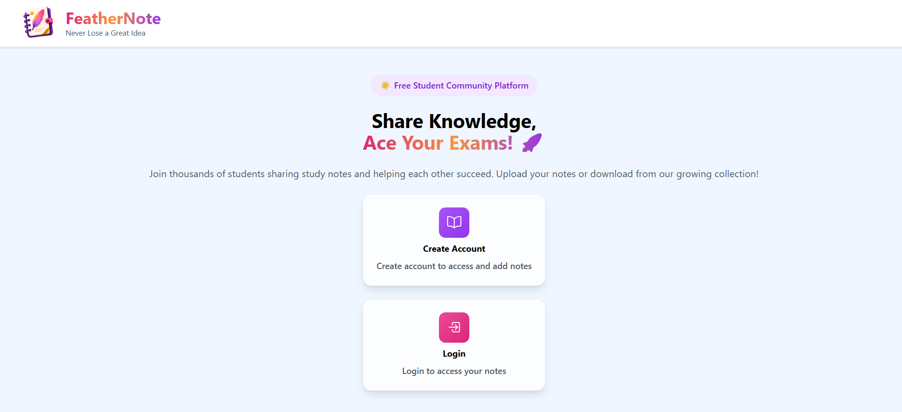
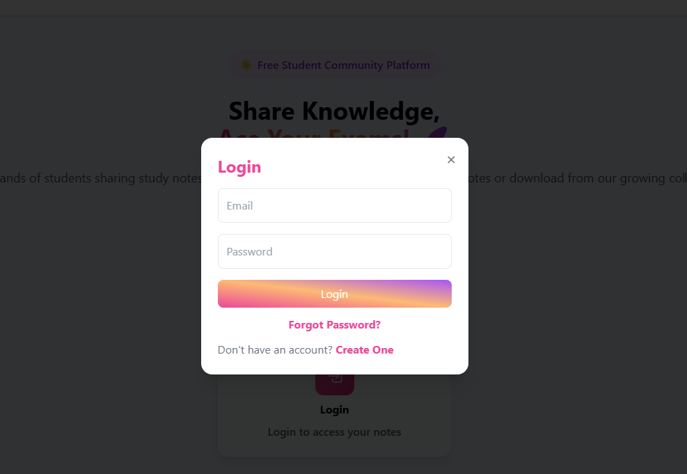
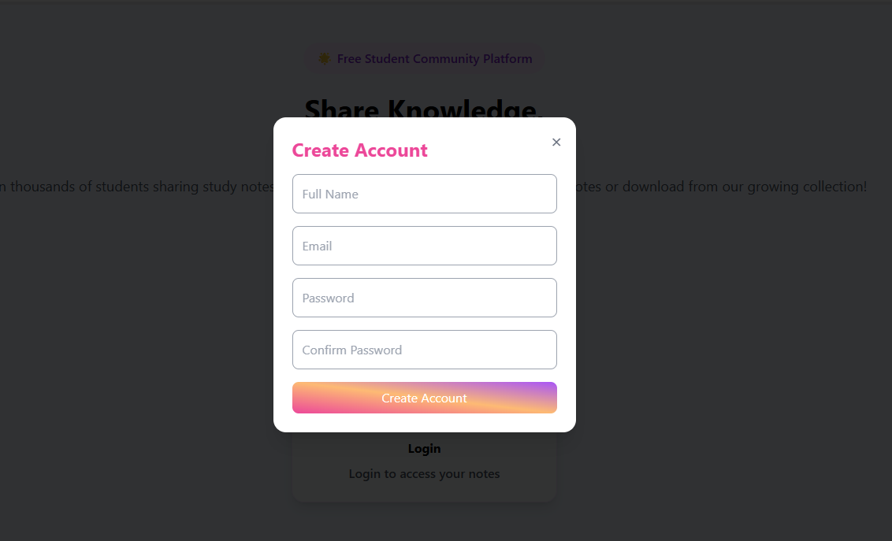
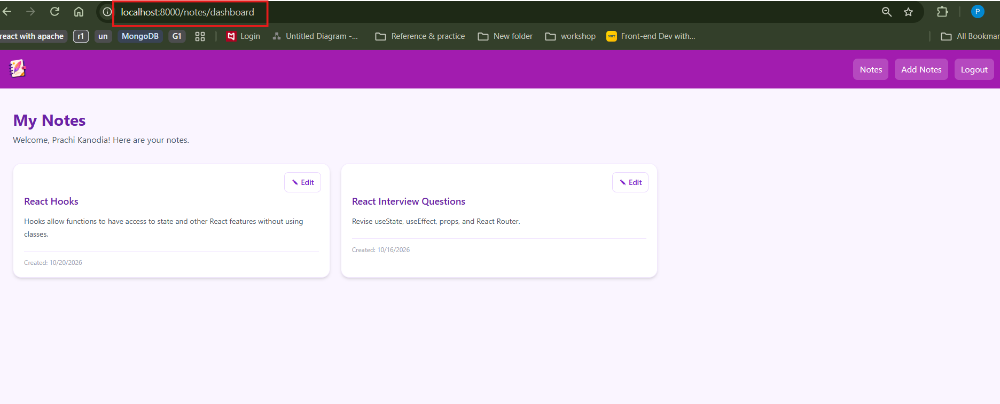
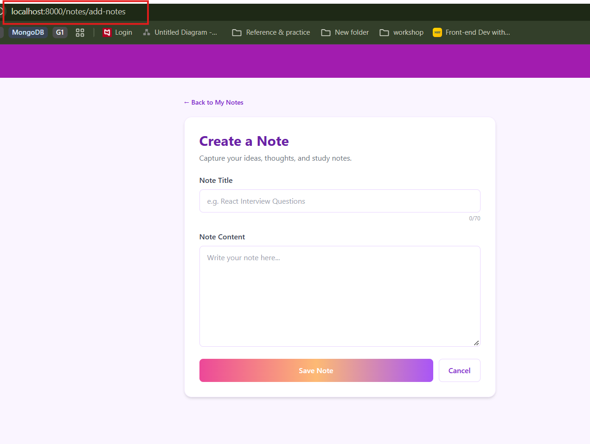

# React-Notes-App

**Work in Progress**

# Notes Application

A full-stack Notes Application built as a learning project to strengthen my skills in **React, Tailwind CSS, Node.js, Express.js, and MongoDB**.

The application is being developed incrementally, starting with the user interface and authentication flow. The current progress includes:

* Landing page with navigation and application options
* Create Account functionality
* Login functionality
* User authentication with JWT
* Protected routes and post-login navigation
* Dashboard/Home page after successful login

### Current Focus

I am currently working on the **authentication flow, protected routes, user specific access, and logout functionality**. The next phase will focus on implementing user-specific notes with **Create, Read, Update, and Delete (CRUD)** operations.

This repository documents my learning journey and progress as I build the application step by step.

Sneak peek into: 

Landing Page -

Login Popup - 

Create Account Popup - 

Dashboard with Notes added - 

Create Notes Page - 
