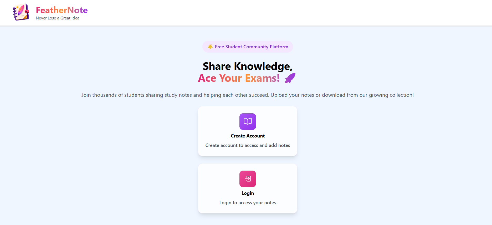
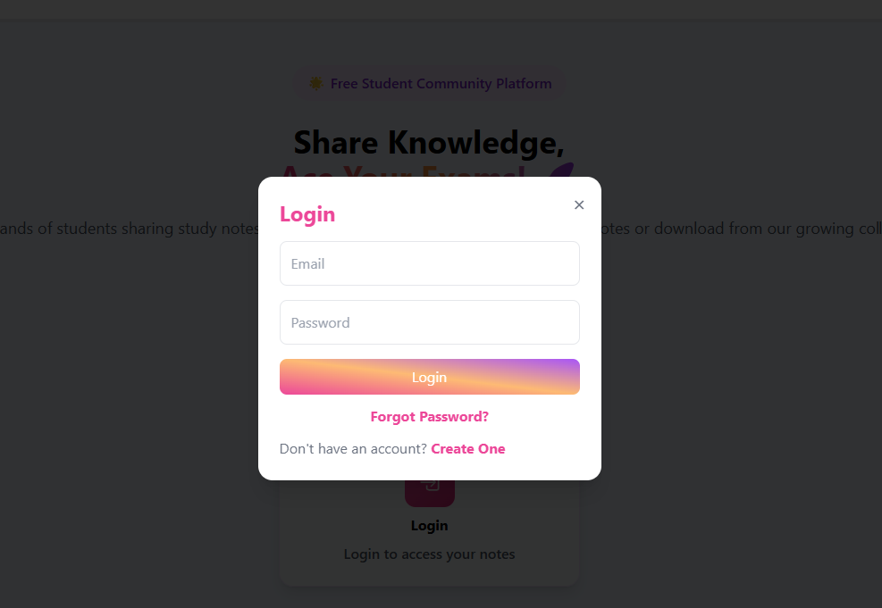
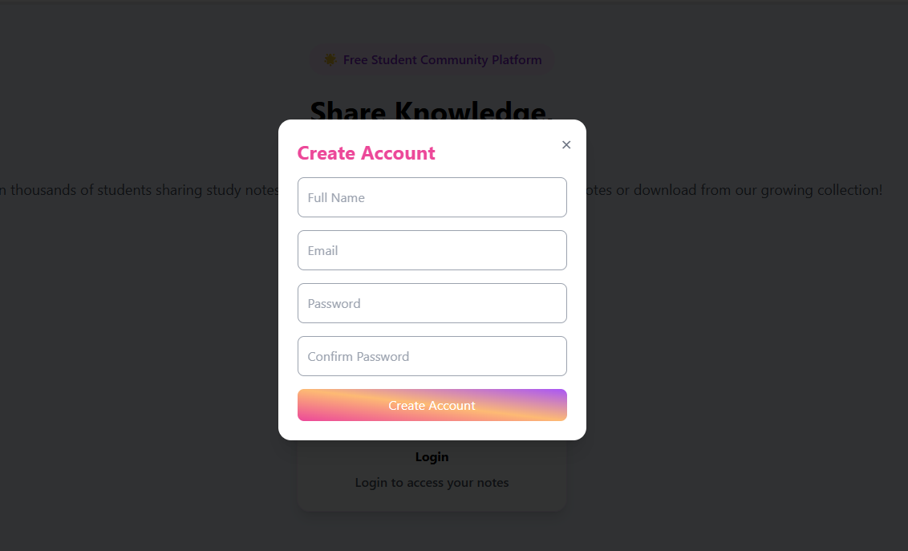
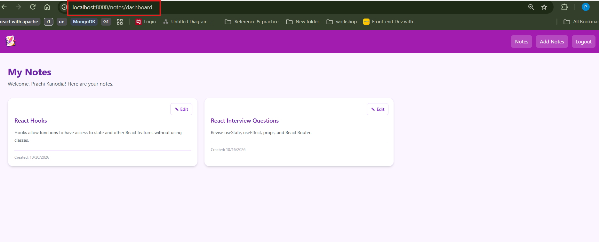
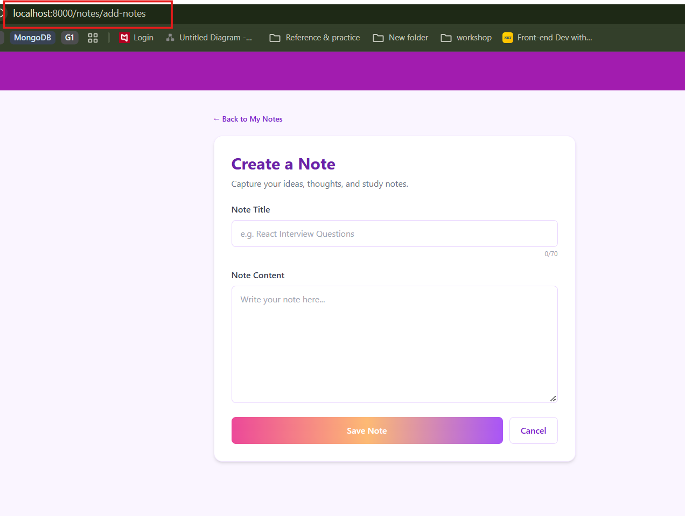
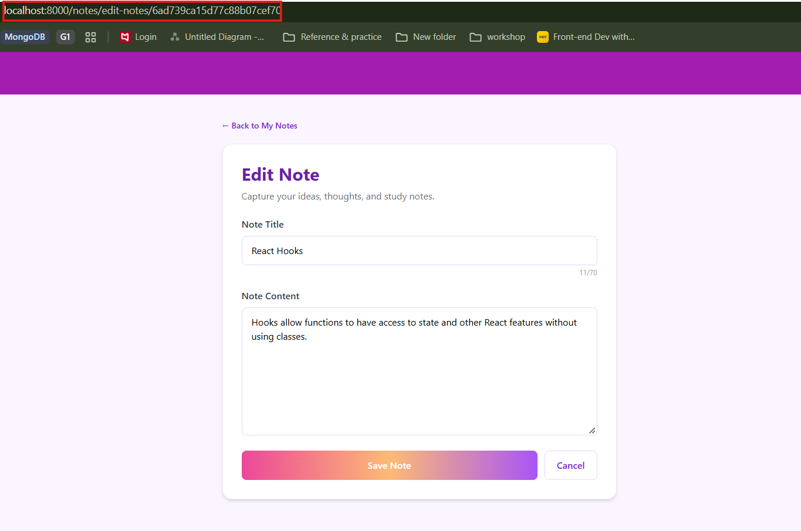

# React-Notes-App

**Work in Progress**

## Notes Application

A full-stack Notes Application built as a learning project to strengthen my skills in **React, Tailwind CSS, Node.js, Express.js, and MongoDB**.

The application is being developed incrementally, starting with the user interface and authentication flow. The current progress includes:

* Landing page with navigation and application options
* Create Account functionality
* Login functionality
* User authentication with JWT
* Protected routes and post-login navigation
* Dashboard/Home page after successful login
* Authentication flow, protected routes, user specific access
* Logout functionality
* User-specific notes management (CRUD operations) – in progress

## Development Approach

* Following a step-by-step development approach, implementing and testing individual features.
* Leveraging Generative AI tools (ChatGPT, Claude and Gemini) through structured prompt engineering to plan development activities, break down requirements into manageable tasks, assist with UI design and styling, accelerate learning, understand technical concepts, support testing and debugging, and resolve development issues.
* Focusing on hands-on implementation to strengthen practical development skills.

## Current Focus

I am currently working on implementing user-specific notes with **Create, Read, Update, and Delete (CRUD)** operations.

This repository documents my learning journey and progress as I build the application step by step.

Sneak peek into: 

Landing Page -

Login Popup - 

Create Account Popup - 

Dashboard Displays/Reads Notes - 

Create Notes Page - 

Edit/Update Notes Page - prefilled data appears
